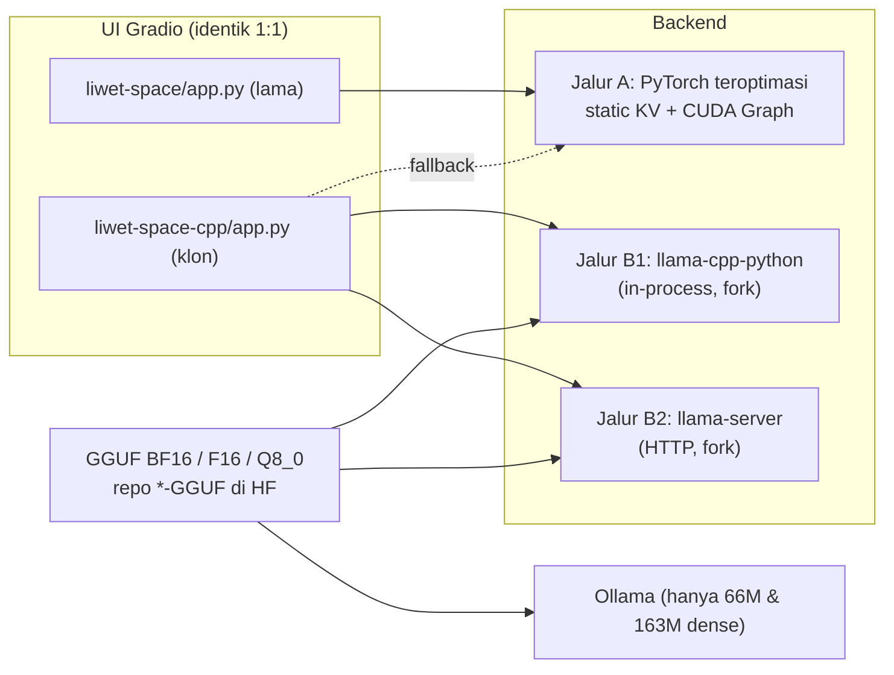
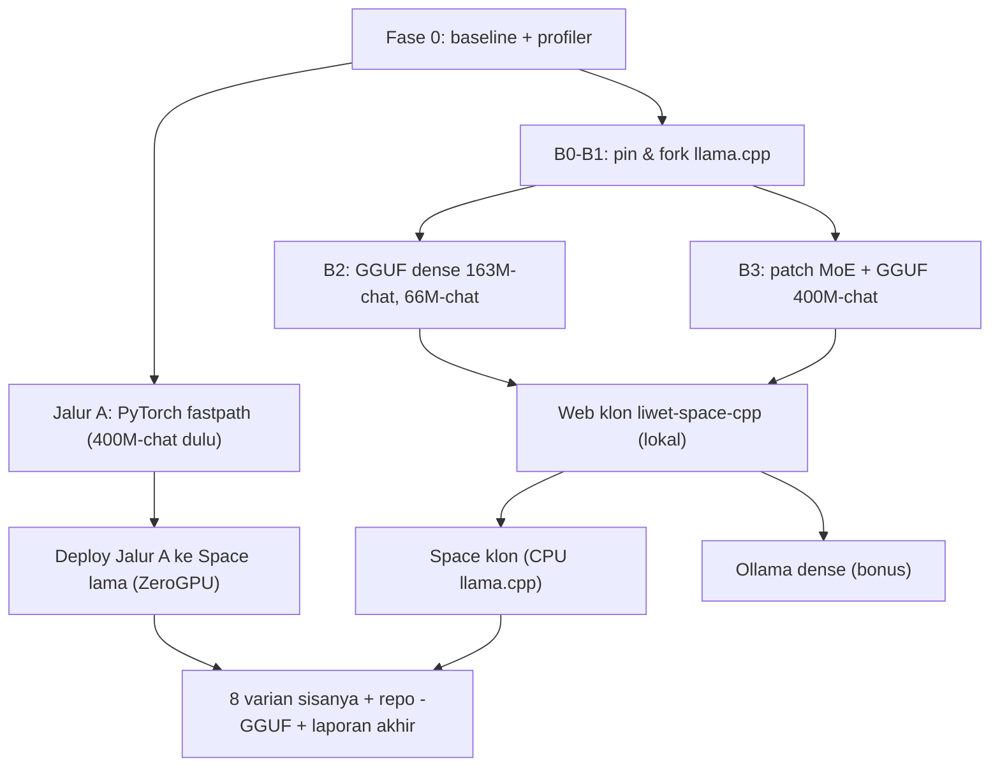

# Liwet-LLM — Rencana Optimasi Inferensi (Lokal GPU, HF ZeroGPU, llama.cpp)

> **Untuk agent eksekutor:** Dokumen ini adalah spesifikasi kerja. Kerjakan fase **berurutan**. Setiap fase punya **Gate** (kriteria lulus). Jangan lanjut ke fase berikutnya sebelum Gate lulus dan hasilnya dicatat di `docs/bench/RESULTS.md`. Jika ada keputusan yang tidak tercakup di sini, **berhenti dan tanya pemilik repo** (aturan *zero assumption*).

---

## 0. Ringkasan Keputusan (sudah disetujui pemilik)

| Topik | Keputusan |
|---|---|
| Strategi | **Dua jalur**: (A) optimasi PyTorch yang ada **tanpa mengubah output**, (B) **web klon 1:1 baru** dengan backend llama.cpp (GGUF). Web lama tetap ada sebagai fallback. |
| Prioritas platform | 1) **Lokal GPU** (RTX 4050 Laptop 6 GB), 2) **HF Space ZeroGPU** (kuota GPU harian terbatas, tidak ada upgrade berbayar). Lokal CPU & Ollama = bonus. |
| Kuantisasi | **BF16/F16** (referensi identik) + **Q8_0** (hampir lossless, default cepat). Q4 **tidak** dipakai. |
| 400M MoE | **Patch kecil llama.cpp (fork)** agar routing identik. Konsekuensi: 400M **tidak jalan di Ollama standar**. Jalur PyTorch teroptimasi tetap jadi cadangan. |
| Cakupan model | Ke-11 varian. Urutan: `400M-A188M-id-chat` → `163M-id-chat` → `66M-id-chat` → sisanya. |
| Distribusi GGUF | Repo HF baru per model berakhiran **`-GGUF`**. Repo safetensors asli **tidak disentuh**. |
| Backend llama.cpp | **llama-cpp-python** (in-process; untuk Gradio & ZeroGPU) **dan** **llama-server** (HTTP; untuk lokal). |
| Target kecepatan (400M-A188M, decode) | Lokal GPU **≥ 100 tok/s**, HF Space **≥ 15 tok/s**, Lokal CPU **≥ 25 tok/s**. |

**Syarat mutlak "tanpa mengubah apapun":** arsitektur, bobot, tokenizer, format prompt, parameter sampling default, dan UI **tidak boleh berubah perilakunya**. Semua optimasi harus lolos uji paritas di [§3](#3-protokol-uji-paritas-wajib-di-setiap-fase).

---

## 1. Diagnosis Awal (temuan dari pembacaan kode)

### 1.1 Gejala
- 400M-A188M (MoE, **187.8M parameter aktif**) hanya **~1 tok/s di Gradio lokal** pada RTX 4050, padahal Gemma E2B via Ollama di mesin yang sama bisa ~100 tok/s.
- Secara teori, model 188M-aktif BF16 (~376 MB dibaca per token) di GPU ~192 GB/s seharusnya dibatasi bandwidth di **ratusan tok/s**. Jadi **1 tok/s bukan batas arsitektur** — ada bottleneck patologis di runtime/app.

### 1.2 Fakta lingkungan
- Proses Gradio lokal: interpreter `tubes_venv` (base: conda env `sana`), **torch 2.13.0+cu130**, CUDA aktif, Gradio 6.31 di venv. Model memang dimuat di GPU (terlihat di `nvidia-smi`).
- Laptop punya isu **throttling Intel DTT/IPF** (GPU bisa dikunci ~30 W, CPU ~2.2 GHz). Ini memperlambat Python dispatch, tapi **tidak** menjelaskan 1 tok/s sendirian.
- HF Space README menyebut "CPU-first", namun hardware aktual = **ZeroGPU** (dekorator `spaces.GPU` di [app.py](../liwet-space/app.py#L16-L22)).
- Ollama 0.40.11 terpasang tetapi gagal start (`Unable to init instance`) — perlu diperbaiki terpisah sebelum fase Ollama.

### 1.3 Kandidat bottleneck di kode (harus dikonfirmasi profiler di Fase 0)
| # | Lokasi | Masalah | Dampak |
|---|---|---|---|
| B1 | [`stream_generate`](../liwet-space/liwet_models.py#L1392-L1507) | Loop decode Python *eager*: 32 layer × puluhan kernel kecil per token, dispatch dari CPU (yang di-throttle). | Sangat besar (launch-bound) |
| B2 | [`MoEAttention400M.forward`](../liwet-space/liwet_models.py#L944-L985), [`DenseAttention163M.forward`](../liwet-space/liwet_models.py#L690-L724) | `torch.cat` KV-cache setiap token (realokasi O(n)), lalu `repeat_interleave` K/V (copy 4×) setiap token. | Besar, tumbuh dengan panjang konteks |
| B3 | [`MoE.forward` fast path](../liwet-space/liwet_models.py#L860-L872) | `gate_up_proj[experts]`/`down_proj[experts]` menyalin bobot 2 expert per layer per token (~4.4 MB × 32 layer). | Sedang |
| B4 | [`stream_generate` L1446-L1448](../liwet-space/liwet_models.py#L1446-L1448) | `torch.unique` atas seluruh buffer token setiap langkah (repetition penalty). | Sedang |
| B5 | [`stream_generate` L1475-L1487](../liwet-space/liwet_models.py#L1475-L1487) | `.item()` sync tiap token + `tokenizer.decode` **seluruh** token tergenerasi tiap langkah (O(n²)) + `yield` ke Gradio tiap token. Waktu konsumen Gradio **ikut terhitung** di `tokens_per_second`. | Sedang–besar (UI-bound) |
| B6 | [`chat_send`](../liwet-space/app.py#L424-L431), [`lab_generate`](../liwet-space/app.py#L673), [`arena_run`](../liwet-space/app.py#L536) | `_is_repo_available(..., force_refresh=True)` untuk 400M **setiap request** → panggilan jaringan ke HF Hub (timeout 2.5 s). | Latensi per pesan |
| B7 | [`chat_send` L463-L464](../liwet-space/app.py#L463-L464) | Seluruh riwayat chat di-*yield* ulang tiap token (serialisasi + websocket + render Markdown). | UI-bound |
| B8 | Hardware | Throttling DTT (`SW Thermal Slowdown` / `SW Power Capping`). | Faktor pengali |

> [!IMPORTANT]
> Jangan mengoptimasi berdasarkan tebakan. Fase 0 wajib memisahkan **waktu model murni** vs **overhead Gradio** vs **throttling**.

---

## 2. Arsitektur Target



Prinsip kunci jalur B: **tokenisasi, detokenisasi, format prompt, stop-check, dan pemotongan konteks tetap dikerjakan di Python dengan `tokenizers` asli**; llama.cpp hanya menerima **token ID** dan mengembalikan logits/token. Ini menghilangkan risiko perbedaan tokenizer GGUF sama sekali.

---

## 3. Protokol Uji Paritas (wajib di setiap fase)

Buat `scripts/parity/` berisi:

1. **`prompts.jsonl`** — minimal 30 prompt per `prompt_mode` (`raw`, `raw_bos`, `instruct_plain`, `chat_tags`, `chat_role`), campuran pendek/panjang (≥ 1.500 token untuk model 2.048-ctx), termasuk multi-turn dan teks dengan karakter non-ASCII/emoji.
2. **`reference_dump.py`** — jalankan **kode asli yang belum dioptimasi** (salin [liwet_models.py](../liwet-space/liwet_models.py) apa adanya ke `scripts/parity/reference/liwet_models_ref.py`) dan simpan:
   - logits token terakhir setelah prefill (fp32, CPU) dan (bf16, CUDA);
   - 128 token **greedy** (`temperature=0`, `repetition_penalty=1.0`) dan 128 token greedy dengan `repetition_penalty` default model;
   - untuk 400M: **indeks expert terpilih per layer per token** (hook pada `MoE.forward`).
3. **`compare.py`** — membandingkan backend kandidat terhadap referensi dengan metrik berikut.

| Uji | Metrik | Gate lulus |
|---|---|---|
| P1 Logit | max-abs-diff, cosine, top-1 sama | Same-dtype (bf16 vs bf16): cosine ≥ 0.9999, top-1 sama 100%. GGUF BF16/F16: cosine ≥ 0.999, top-1 ≥ 99%. Q8_0: cosine ≥ 0.995, top-1 ≥ 97%. |
| P2 Greedy | indeks divergensi pertama dari 128 token | Same-dtype: 100% identik pada ≥ 95% prompt; sisanya hanya boleh diverge di posisi dengan selisih logit top-1 vs top-2 < 0.05. GGUF BF16/F16: median divergensi ≥ 96 token. Q8_0: median ≥ 48 token (dilaporkan, bukan blocker). |
| P3 Router (400M) | % token-layer dengan set expert sama | BF16/F16: ≥ 99.5%. Q8_0: ≥ 97%. |
| P4 Sampling | histogram token pada 500 seed untuk 5 prompt (temperature 0.65, top-k 40, top-p 0.9) | Total-variation distance antar backend ≤ 0.05 (RNG berbeda → tidak bisa bitwise). |
| P5 UI | checklist semua tab, kontrol, preset, label, CSS, telemetri | 100% item sama. |

Semua hasil ditulis ke `docs/bench/RESULTS.md` (tabel per model × backend × dtype).

---

## 4. Fase 0 — Benchmark & Profiling Baseline (WAJIB, sebelum mengubah kode)

### 4.1 Prasyarat mesin (lokal)
- Untuk benchmark puncak, pemilik menjalankan `C:\Users\Fadhilah\Desktop\Matikan_Intel_Throttling.bat` **sebagai Administrator** (eksekutor **tidak** menjalankannya sendiri; minta ke pemilik). Setelah selesai, pemilik dapat memulihkan dengan `Kembalikan_Intel_Throttling.bat`.
- Catat status throttle sebelum & sesudah setiap run:
  ```powershell
  nvidia-smi -q -d PERFORMANCE,POWER,CLOCK | Out-File docs\bench\gpu_state_<run>.txt
  ```
- Tutup Gradio lain yang memegang GPU. Gunakan interpreter yang sama dengan server lokal (`tubes_venv`).

### 4.2 Skrip benchmark headless — `scripts/bench/bench_torch.py`
- Import `liwet_models` dari `liwet-space`, muat model dari folder lokal `TUBES_1_SAFETENSOR/<repo>` (tanpa jaringan).
- Ukur terpisah: **waktu load**, **prefill** (prompt 32/512/1.500 token), **decode** 256 token dengan `torch.cuda.synchronize()` di batas pengukuran, **tanpa Gradio**.
- Mode: (a) loop `stream_generate` apa adanya, (b) forward murni tanpa sampling/decode-teks — untuk memisahkan biaya model vs biaya loop.
- Output JSON: `tok/s`, ms/token p50/p95, VRAM puncak, clock SM rata-rata.

### 4.3 Profiling
- `torch.profiler` (CPU+CUDA) untuk 20 token decode → export Chrome trace ke `docs/bench/trace_<model>.json`. Laporkan: jumlah kernel per token, % waktu GPU idle, top-10 op.
- Ukur juga **di dalam Gradio**: tambahkan logging sementara (di branch terpisah) waktu antar-`yield` vs waktu forward, untuk mengonfirmasi B5/B7.

### Gate Fase 0
`docs/bench/RESULTS.md` berisi baseline untuk 3 model chat (lokal GPU, lokal CPU) + diagnosis bottleneck yang **terbukti** (dengan angka), bukan dugaan.

---

## 5. Jalur A — Optimasi PyTorch Tanpa Mengubah Output

Kerjakan di branch `perf/torch-fastpath`. Semua perubahan bersifat **internal**; API publik `liwet_models` (`load_liwet_model`, `stream_generate`, `generate_text`, `build_prompt_from_messages`, dll.) dan signature fungsi app **tetap**. Jaga semua komentar/docstring yang sudah ada.

### A1. Perbaikan level app (risiko nol terhadap output)
1. **Hilangkan cek Hub per request** (B6): ganti `force_refresh=True` dengan cache TTL yang sudah ada; cek ulang hanya di startup/tombol refresh. Perilaku "Coming Soon" tetap sama.
2. **Throttle `yield` UI** (B5/B7): kirim update ke Gradio paling cepat tiap **50 ms** atau tiap **8 token** (mana yang lebih dulu), dan selalu kirim update final. Teks akhir identik.
3. **Pisahkan pengukuran tok/s**: `stats["seconds"]` harus mengukur waktu generasi model saja (akumulasi waktu di dalam generator, bukan waktu konsumen). Tambahkan field baru `wall_seconds` untuk end-to-end; jangan ubah format tabel yang ada kecuali menambah kolom bila pemilik setuju.
4. **Detokenisasi inkremental**: decode hanya jendela token terakhir (mis. 8 token) dan tangani byte UTF-8 yang belum lengkap (ByteLevel BPE) — hasil string akhir **harus identik** dengan `tokenizer.decode(all_ids)`; tambahkan assert di mode debug.

### A2. Loop decode di GPU
1. **Repetition penalty tanpa `torch.unique`** (B4): pertahankan `seen_mask` boolean ukuran vocab di GPU, set `True` untuk token prompt & setiap token baru. Rumus penalty sama persis (`/penalty` bila logit > 0, `*penalty` bila ≤ 0). Ini ekuivalen matematis dengan himpunan `unique`.
2. Sampling (temperature → top-k → top-p → multinomial) **urutan tetap sama** seperti sekarang.
3. Stop-check tetap pakai `.item()` per token (murah setelah CUDA Graph); boleh dioptimasi belakangan hanya jika profiler menunjukkan signifikan.

### A3. Static KV-cache + GQA tanpa copy (B2)
1. Alokasikan sekali per bundle: `k_cache, v_cache` berbentuk `[n_layers, 1, n_kv_heads, max_ctx, head_dim]` (dtype model). Tulis posisi baru dengan `index_copy_`/slicing in-place; jangan `torch.cat`.
2. Ganti `repeat_interleave` dengan `F.scaled_dot_product_attention(..., enable_gqa=True)` (torch ≥ 2.5; env lokal 2.13 ✓). Untuk HF, set `torch>=2.5` di `requirements.txt` Space.
3. Saat decode, attention atas panjang tetap `max_ctx` dengan **mask aditif** (`-inf` di luar panjang aktif) agar shape statis (prasyarat CUDA Graph). Prefill tetap eager dengan `is_causal=True`.
4. Terapkan ke ketiga keluarga: `MiniCausalSelfAttention` (MHA), `DenseAttention163M`, `MoEAttention400M`. Implementasikan sebagai **jalur baru** (mis. `forward_static(...)`) dan pertahankan jalur lama untuk referensi & fallback (`LIWET_FASTPATH=0`).

### A4. CUDA Graph untuk satu langkah decode (B1 — dampak terbesar)
1. Implementasi **manual `torch.cuda.CUDAGraph`** (tidak butuh Triton → aman di Windows): buffer statis untuk token input, posisi, mask, KV-cache, output logits. Warm-up 3× di side stream, capture 1 langkah decode, lalu `replay()` per token.
2. Syarat capture: tidak ada `.item()`, tidak ada percabangan Python berbasis nilai tensor, tidak ada alokasi baru di dalam langkah. Fast path MoE (`num_tokens == 1`) memenuhi syarat (percabangan berbasis shape Python).
3. Satu graph per (model, dtype, max_ctx). Simpan di `LiwetBundle` (tambah field opsional, default `None`). Bebaskan saat bundle di-evict dari LRU.
4. Opsi lanjutan (hanya jika A4 manual belum mencapai target): `torch.compile(mode="reduce-overhead", fullgraph=True, dynamic=False)` dengan paket `triton-windows` di lokal.
5. Jika graph gagal di-capture → log peringatan dan jatuh ke jalur eager (perilaku identik).

### A5. CPU (lokal CPU & fallback)
- Tetap **float32** di CPU (seperti sekarang; jangan ganti ke bf16 karena mengubah numerik).
- `torch.set_num_threads(<jumlah core fisik>)` dan `torch.set_num_interop_threads(1)` saat device CPU.
- Static KV-cache & GQA tanpa copy (A3) juga dipakai di CPU. CUDA Graph tidak berlaku.

### A6. Penyesuaian ZeroGPU (HF Space)
1. **Muat model chat prioritas di scope global** saat startup (pola resmi ZeroGPU: `.to("cuda")` di level modul; paket `spaces` menangani pemindahan). Model lain tetap lazy dengan LRU yang ada.
2. Set `@spaces.GPU(duration=...)` realistis (mis. 20 s untuk chat/lab, 45 s untuk arena 3 model) — durasi lebih kecil memperbaiki prioritas antrean dan menghemat kuota.
3. CUDA Graph yang di-capture dalam satu panggilan ZeroGPU **tidak dijamin** bertahan antarpanggilan. Lakukan capture **di dalam** fungsi berdekorator dengan cache per-proses dan fallback eager bila invalid. Opsi lanjutan: AoT compile ZeroGPU (`spaces.aoti_capture` / `aoti_compile` / `aoti_apply`) untuk langkah decode — verifikasi dulu ketersediaan API pada versi `spaces` yang terpasang.
4. Pertimbangkan jalur llama.cpp **CPU** di Space (Jalur B) agar inferensi tidak menghabiskan kuota GPU harian sama sekali; ukur `os.cpu_count()` dan tok/s di Space.

### Gate Jalur A
- P1, P2, P3 lulus (same-dtype) terhadap referensi untuk 3 model chat; P5 lulus.
- Lokal GPU 400M-A188M decode ≥ 100 tok/s (headless) dan terlihat wajar di UI (selisih UI vs headless ≤ 20%).
- `LIWET_FASTPATH=0` mengembalikan perilaku lama persis.

---

## 6. Jalur B — Konversi GGUF & Fork llama.cpp

### B0. Pin versi & fork
1. Pilih rilis **llama-cpp-python** terbaru yang stabil; catat commit `vendor/llama.cpp`-nya. Fork `ggml-org/llama.cpp` di commit **tersebut** (bukan HEAD) supaya llama-cpp-python bisa dibangun dari fork tanpa ketidakcocokan API.
2. Repo fork: `fadhilahkhairogi/llama.cpp` branch `liwet-moe`. Catat commit di `docs/bench/RESULTS.md`.

### B1. Pemetaan arsitektur (hasil inspeksi checkpoint)

| Item | 66M (`MiniTransformer`) | 163M (Dense GQA) | 400M-A188M (MoE GQA) |
|---|---|---|---|
| Layer / hidden / heads (Q/KV) / head_dim | 12 / 512 / 8/8 / 64 | 16 / 768 / 12/4 / 64 | 32 / 1024 / 16/4 / 64 |
| FFN | SwiGLU `w1`(gate) `w3`(up) `w2`(down), 2048 | SwiGLU `gate_up_proj` fused (gate = setengah pertama), 3072 | 8 expert, top-2, `moe_intermediate_size` 360, tanpa shared expert |
| Attention weights | `qkv` fused `[3·512, 512]` | `qkv_proj` fused `[q+2kv, 768]` | `q_proj`/`k_proj`/`v_proj` terpisah |
| RMSNorm eps | **1e-6** (hard-coded di `MiniRMSNorm`, tidak ada di config!) | 1e-5 | 1e-5 |
| RoPE | rotate_half (gaya NeoX), θ=10000 | sama | sama |
| Embedding | tied (`tok_emb` = `lm_head`) | tied | tied |
| Vocab / ctx | 32003 / 1024 | 32000 / 2048 | 32000 / 2048 |
| Tokenizer | ByteLevel BPE, regex GPT-2, **normalizer NFC**, special `<\|user\|>` `<\|assistant\|>` `<\|end\|>` dst. | ByteLevel BPE, regex GPT-2, tanpa normalizer, special `<pad> <bos> <eos> <unk>` | sama dengan 163M |
| Router | — | — | `topk(logits + expert_bias)`; bobot = softmax-penuh di-*gather* lalu renormalisasi. **`expert_bias` ≠ 0** (abs-max 2.77, rata-rata 0.83) |

### B2. Langkah konversi model dense (66M, 163M) — llama.cpp & Ollama standar
1. `scripts/gguf/export_hf_llama.py`: ubah checkpoint Liwet → folder format **HF `LlamaForCausalLM`**:
   - pecah `qkv`/`qkv_proj` → `q_proj`, `k_proj`, `v_proj`; pecah `gate_up_proj` → `gate_proj`, `up_proj`; rename `w1→gate_proj`, `w3→up_proj`, `w2→down_proj`, norm & embedding ke nama HF.
   - `config.json` Llama dengan `rms_norm_eps` yang **benar per keluarga** (66M = 1e-6), `tie_word_embeddings=true`, `rope_theta=10000`, `num_key_value_heads`, `max_position_embeddings`, `bos/eos` id.
   - salin `tokenizer.json` + buat `tokenizer_config.json` yang valid.
2. **Gate perantara**: muat folder tersebut dengan `transformers.LlamaForCausalLM` dan jalankan P1/P2 terhadap referensi (fp32 CPU) → harus identik (cosine ≥ 0.99999). Ini membuktikan pemetaan RoPE/norm/split benar sebelum menyentuh GGUF.
3. Konversi: `python convert_hf_to_gguf.py <folder> --outtype bf16` lalu `--outtype f16`, dan `llama-quantize ... Q8_0`.
   - Tokenizer kustom akan memicu error *chkhsh* tidak dikenal → di fork, tambahkan hash tersebut ke `get_vocab_base_pre()` dengan `res = "gpt-2"` (pre-tokenizer ByteLevel regex GPT-2). **Verifikasi** dengan `llama-tokenize` bahwa token ID identik dengan `tokenizers` asli untuk seluruh `prompts.jsonl` (dipakai oleh Ollama/CLI; app sendiri mengirim token ID).
   - NFC (66M): llama.cpp tidak menerapkan normalizer → di app, tetap tokenisasi via `tokenizers` asli (sudah NFC). Untuk Ollama, catat sebagai keterbatasan yang diketahui.

### B3. Patch fork untuk 400M MoE (routing identik)
Observasi matematis: bobot Liwet = softmax-penuh di-gather lalu dinormalisasi = **softmax atas logit expert terpilih**. Ini sama dengan gating `SOFTMAX_WEIGHT` llama.cpp; ditambah bias seleksi `exp_probs_b` yang **dijumlahkan ke logit sebelum top-k**. Verifikasi di commit yang di-pin bahwa `build_moe_ffn` melakukan: `probs = logits` (SOFTMAX_WEIGHT) → `selection = probs + exp_probs_b` → `argsort_top_k(selection)` → `weights = get_rows(probs)` → `softmax(weights)`. Jika urutannya berbeda, sesuaikan patch agar tepat sama dengan [`MoE.forward`](../liwet-space/liwet_models.py#L849-L872).

Patch minimal (perkiraan ±40 baris):
1. **Loader** (`src/llama-model.cpp`, `LLM_ARCH_LLAMA`): muat opsional `blk.%d.exp_probs_b` (`TENSOR_NOT_REQUIRED`, shape `{n_expert}`) dan baca opsional KV `llama.expert_gating_func` (default tetap SOFTMAX agar Mixtral tidak berubah).
2. **Tensor map** (`src/llama-arch.cpp`): daftarkan `LLM_TENSOR_FFN_EXP_PROBS_B` untuk `LLM_ARCH_LLAMA`.
3. **Graph** (builder Llama): teruskan `layer.ffn_exp_probs_b` dan `hparams.expert_gating_func` ke `build_moe_ffn` (sebelumnya `nullptr` & SOFTMAX), `norm_w=false` saat SOFTMAX_WEIGHT.
4. **Converter** (`convert_hf_to_gguf.py`): ekspor 400M sebagai HF `MixtralForCausalLM` + tensor tambahan `model.layers.N.block_sparse_moe.gate.e_score_correction_bias` dan config `"liwet_selection_bias": true`; converter memetakan tensor itu ke `blk.N.exp_probs_b` (f32) dan menulis `expert_gating_func = SOFTMAX_WEIGHT` (verifikasi nilai enum di commit yang di-pin).
   - Pemetaan expert: `gate_up_proj[E, H, 2I]` → `w1`(gate) = `[:, :, :I]ᵀ`, `w3`(up) = `[:, :, I:]ᵀ`; `down_proj[E, I, H]` → `w2` = `ᵀ`. `load_ema` **tidak** diekspor (hanya statistik training).
5. Llama.cpp stok akan **menolak** GGUF ini ("wrong number of tensors") — itu disengaja agar tidak berjalan diam-diam dengan routing salah. Tulis ini di README repo `-GGUF`.
6. **Gate**: P3 router parity (pakai `llama-eval-callback` / callback eval untuk dump tensor top-k expert) + P1/P2.
7. Usulkan patch ke upstream sebagai PR opsional (generik: "optional selection bias + gating func for llama MoE") — tidak memblokir proyek.

### B4. Build (Windows, lokal)
- Prasyarat: VS 2022 Build Tools (C++), CMake ≥ 3.28, CUDA Toolkit yang cocok dengan driver 610.88, Ninja.
- llama.cpp fork: `cmake -B build -G Ninja -DGGML_CUDA=ON -DCMAKE_CUDA_ARCHITECTURES=89 -DLLAMA_CURL=OFF` → `cmake --build build --config Release`. Hasil: `llama-server.exe`, `llama-cli.exe`, `llama-quantize.exe`, `llama-tokenize.exe`, `llama-bench.exe`, `llama-eval-callback.exe`.
- llama-cpp-python dari fork: clone llama-cpp-python di tag terpin, arahkan submodule `vendor/llama.cpp` ke fork, lalu `set CMAKE_ARGS=-DGGML_CUDA=on -DCMAKE_CUDA_ARCHITECTURES=89` dan `pip install . --no-build-isolation`.
- Ukur dengan `llama-bench -m <gguf> -p 512 -n 256 -ngl 99` untuk BF16/F16/Q8_0 — catat di RESULTS.

### B5. Build untuk HF Space (ZeroGPU)
- ZeroGPU pada dasarnya kompatibel dengan PyTorch; GPU hanya terpasang selama fungsi `@spaces.GPU` berjalan. Karena itu jalur llama.cpp di Space dirancang **CPU-first**:
  - Bangun **wheel llama-cpp-python CPU** dari fork (Linux x86_64, AVX2) via GitHub Actions di repo fork; publikasikan sebagai GitHub Release dan rujuk URL wheel di `requirements.txt` Space klon.
  - Opsional: wheel CUDA dan muat model **di dalam** fungsi `@spaces.GPU` (reload per panggilan; GGUF kecil). Hanya dipakai jika benchmark membuktikan lebih cepat end-to-end dibanding CPU **dan** pemilik setuju memakai kuota.
- Target Space: 400M-A188M Q8_0 ≥ 15 tok/s di CPU Space.

### B6. Repo HF `-GGUF` (per model, 11 repo)
- Nama: `fadhilahkhairogi/<RepoAsli>-GGUF`, isi: `<nama>-BF16.gguf`, `<nama>-F16.gguf`, `<nama>-Q8_0.gguf`, `README.md` (asal checkpoint, commit fork, hasil paritas, instruksi), `tokenizer.json` asli, dan untuk dense: `Modelfile`.
- Upload dengan `huggingface-cli upload` setelah Gate B3/B2 lulus. **Jangan** mengubah repo safetensors asli.

---

## 7. Jalur B — Web Klon 1:1: `liwet-space-cpp/`

### 7.1 Struktur
```
liwet-space-cpp/
  app.py                  # salinan app.py lama; satu-satunya perbedaan: import backend
  liwet_backend.py        # adapter: API sama dengan liwet_models yang dipakai app.py
  backends/
    torch_backend.py      # re-export liwet-space/liwet_models (fallback)
    llamacpp_inproc.py    # llama-cpp-python
    llamacpp_server.py    # klien HTTP llama-server
  gguf_catalog.py         # repo_id -> repo -GGUF + nama file per dtype
  requirements.txt
  README.md               # front-matter HF Space (sdk gradio, versi sama)
```
- `app.py` klon: **UI, CSS, preset, label, tab (Percakapan, Arena Perbandingan, Uji Parameter), telemetri identik**. Tambahan yang diizinkan hanya dropdown kecil "Backend" & "Presisi (BF16/F16/Q8_0)" di accordion Pengaturan — **minta persetujuan pemilik** sebelum menambah elemen UI apa pun.
- Pemilihan backend via env `LIWET_BACKEND=llamacpp|server|torch` (default lokal: `server` jika `LIWET_SERVER_URL` ada, kalau tidak `llamacpp`; default Space: `llamacpp` CPU).

### 7.2 Kontrak adapter `liwet_backend.py`
Harus mengekspor nama yang sama yang diimport [app.py](../liwet-space/app.py#L24-L33): `DEFAULT_SYSTEM_PROMPT`, `LIWET_CATALOG`, `ModelUnavailableError`, `build_prompt_from_messages`, `check_repo_availability`, `get_model_spec`, `load_liwet_model`, `stream_generate` — dengan perilaku identik:
- `build_prompt_from_messages`, `LIWET_CATALOG`, `get_model_spec`, `_encode_prompt` (BOS & truncation), `_stop_token_ids`, `_clean_reply` → **di-import langsung dari `liwet_models` asli** (single source of truth, jangan disalin).
- `load_liwet_model` mengembalikan objek bundle yang punya atribut yang dipakai app (`spec`, `tokenizer`, `context_len`, `total_params`, `active_params`, `device`, `dtype`, `repo_id`) — isi angka parameter dari spec/metadata asli.
- `stream_generate` (llama-cpp-python, **mode paritas**):
  1. Token ID dari `_encode_prompt` asli → `llm.eval(ids)`.
  2. Tiap langkah ambil logits token terakhir (`llm.eval_logits`/`llama_get_logits`, 32k float), lalu jalankan **sampler Python/NumPy dengan urutan identik** dengan [`stream_generate`](../liwet-space/liwet_models.py#L1446-L1473) (penalty atas semua token prompt+generasi → temperature → top-k → top-p → multinomial; greedy saat `temperature==0`).
  3. Stop-id, marker `\n\nUser:` dll., detokenisasi via `tokenizers` asli, `stats` dengan key yang sama (`text`, `prompt_tokens`, `generated_tokens`, `seconds`, `tokens_per_second`, `truncated`).
  4. Seed: gunakan `numpy.random.Generator(PCG64(seed))` — hasil sampling tidak akan bitwise sama dengan torch, tapi lolos P4.
- **Mode cepat** (opsional, setelah mode paritas lulus): sampler native llama.cpp dengan `samplers=["penalties","temperature","top_k","top_p"]`, `repeat_last_n=-1`, `min_p=0`, `typical_p=1`, nonaktifkan DRY/XTC/mirostat. Verifikasi bahwa token prompt ikut dihitung penalty (perilaku Liwet); jika tidak, tetap pakai mode paritas.
- `llamacpp_server.py`: endpoint `/completion` dengan `prompt` berupa **array token ID**, `n_probs`/logits tidak diperlukan pada mode cepat; untuk mode paritas di server gunakan `/completion` + `n_probs` hanya jika performa memadai, selain itu pakai in-process.

### 7.3 Manajemen model
- Lokal: `llama-server` fork dijalankan per model chat di port berbeda (8081/8082/8083) via skrip `scripts/run_local_servers.ps1` dengan `-ngl 99 -c 2048 --parallel 1`; atau mode router multi-model bila tersedia di commit terpin (verifikasi dulu).
- In-process: LRU maksimal 2 `Llama` instance (sama dengan `MAX_CACHED_BUNDLES` lama); `n_gpu_layers=-1` di lokal GPU, `0` di Space CPU; `n_ctx` = `context_len` model; `n_threads` = core fisik.
- GGUF diunduh dari repo `-GGUF` via `hf_hub_download`, fallback ke folder lokal (`TUBES_1_SAFETENSOR/../GGUF/`).
- Arena tetap menjalankan model **berurutan** (perilaku sama).

### Gate Jalur B
- P1–P5 lulus untuk 3 model chat (lalu 8 lainnya) pada BF16/F16; Q8_0 dilaporkan.
- Lokal GPU 400M-A188M ≥ 100 tok/s (target realistis jauh di atas ini); Lokal CPU ≥ 25 tok/s; Space ≥ 15 tok/s.
- UI klon lolos checklist P5 berdampingan dengan web lama (screenshot tiap tab disimpan di `docs/bench/ui/`).

---

## 8. Ollama (bonus, hanya 66M & 163M)

1. Perbaiki dulu Ollama lokal yang gagal start (cek log `%LOCALAPPDATA%\Ollama\server.log`); di luar cakupan perubahan kode.
2. `Modelfile` per varian dense, `FROM ./<nama>-Q8_0.gguf` (dan varian BF16):
   - `TEMPLATE` mereplikasi persis format `chat_role` (`System: …\n\nUser: …\n\nAssistant:` dengan `<bos>` di depan) / `chat_tags` (`<|user|>\n…\n<|assistant|>\n`) / `instruct_plain` / `raw(_bos)` sesuai [`build_prompt_from_messages`](../liwet-space/liwet_models.py#L1302-L1347).
   - `PARAMETER stop` untuk `\n\nUser:`, `\n\nSystem:`, `<|end|>`, `<|user|>`, `<eos>`; `PARAMETER` default dari `recommended_params` di `LIWET_CATALOG`; `repeat_last_n -1`.
3. Keterbatasan yang wajib ditulis di README `-GGUF`: urutan sampler Ollama tidak bisa diatur (top-p dihitung sebelum temperature), NFC tidak diterapkan untuk 66M, dan 400M MoE **tidak didukung** Ollama standar.

---

## 9. Urutan Kerja & Deliverable



| # | Deliverable | Lokasi |
|---|---|---|
| D1 | Skrip benchmark & profiler, baseline | `scripts/bench/`, `docs/bench/RESULTS.md` |
| D2 | Harness paritas + dump referensi | `scripts/parity/` |
| D3 | PyTorch fastpath (flag `LIWET_FASTPATH`) | `liwet-space/liwet_models.py`, `liwet-space/app.py` (branch `perf/torch-fastpath`) |
| D4 | Fork llama.cpp + patch MoE + wheel CPU (Actions) | `fadhilahkhairogi/llama.cpp@liwet-moe` |
| D5 | Skrip ekspor HF-Llama/Mixtral & konversi GGUF | `scripts/gguf/` |
| D6 | 11 repo `-GGUF` di HF | `huggingface.co/fadhilahkhairogi/*-GGUF` |
| D7 | Web klon 1:1 | `liwet-space-cpp/` (+ Space HF baru, nama dikonfirmasi pemilik) |
| D8 | Modelfile Ollama (dense) | `scripts/ollama/` |
| D9 | Laporan akhir: tabel tok/s & paritas semua model × backend × dtype | `docs/bench/RESULTS.md` |

---

## 10. Risiko & Mitigasi

| Risiko | Mitigasi |
|---|---|
| Throttling DTT mengacaukan angka benchmark | Catat `nvidia-smi -q -d PERFORMANCE` tiap run; minta pemilik menjalankan skrip `.bat` (Admin) untuk run puncak; laporkan kedua kondisi. |
| CUDA Graph gagal di Windows/ZeroGPU | Fallback eager otomatis; opsi `torch.compile` + `triton-windows` (lokal) / AoTI (ZeroGPU). |
| API llama-cpp-python tidak cocok dengan llama.cpp terbaru | Fork **di commit vendor** llama-cpp-python yang terpin (B0). |
| Urutan `build_moe_ffn` berbeda dari asumsi | Baca kode di commit terpin; sesuaikan patch; Gate P3 mendeteksi. |
| BF16 lambat di CUDA llama.cpp | Gunakan F16 sebagai referensi alternatif (cek overflow: semua bobot \|w\| < 65504) dan Q8_0 untuk kecepatan. |
| Tokenizer GGUF beda dengan `tokenizers` | App selalu kirim token ID dari tokenizer asli; GGUF tokenizer hanya untuk Ollama/CLI dan diverifikasi `llama-tokenize`. |
| Kuota ZeroGPU habis | Space klon CPU-first (llama.cpp CPU tidak memakai kuota GPU). |
| Perubahan tak sengaja pada web lama | Semua perubahan Jalur A di balik flag, branch terpisah, P5 checklist, dan web klon di folder baru. |

## 11. Hal yang TIDAK boleh dilakukan eksekutor tanpa persetujuan pemilik
- Mengubah bobot, tokenizer, `LIWET_CATALOG`, format prompt, atau nilai default sampling.
- Menambah/menghapus elemen UI pada web lama, atau menambah elemen UI di web klon selain yang disebut di §7.1.
- Push ke `main`, mengubah/menghapus repo HF safetensors asli, atau membuat Space HF baru dengan nama yang belum dikonfirmasi.
- Menjalankan skrip pengubah layanan sistem (Intel DTT) — hanya pemilik yang menjalankan `.bat` sebagai Administrator.
- Memakai kuantisasi di bawah Q8_0 sebagai default.
